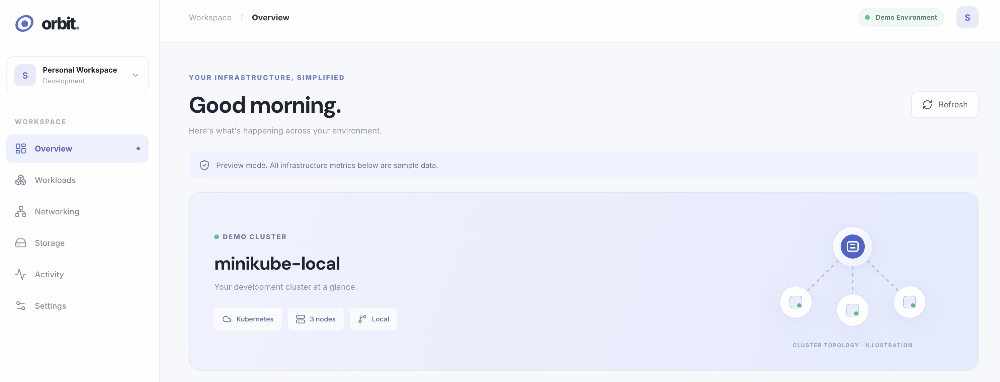

# Orbit 🚀
### Three-Tier Kubernetes Homelab

Orbit is a task manager application I built and deployed on a local Kubernetes cluster to gain hands-on experience with containerized applications and infrastructure.

The application features a functional task manager alongside a dashboard that visually represents my cluster.

## Tech Stack

- **Frontend:** React, Vite, NGINX
- **Backend:** Python, FastAPI
- **Database:** PostgreSQL
- **Infrastructure:** Kubernetes, Docker, Minikube

## Architecture

`Browser → Ingress → Frontend → Backend → PostgreSQL`

Deployed on a seven-node Minikube cluster consisting of one control-plane node and six worker nodes.

## Key Features

- Three-tier containerized application
- Kubernetes Deployments, Services, and Ingress
- Multiple frontend and backend replicas
- Persistent PostgreSQL storage
- Kubernetes Secrets for database credentials
- Rolling deployments and application troubleshooting

## Dashboard

## Purpose

This project was built to strengthen my understanding of Kubernetes, particularly application deployment, networking, persistent storage, and troubleshooting.